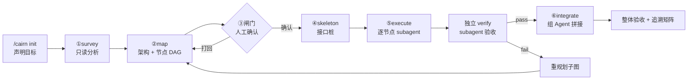

# cairn-pi

**把「需求 → 架构 → 节点骨架 → 逐节点开发 → 整体验收」变成一条可追踪的流水线。**
黑板状态机 + 原生 subagent，每个节点上下文独立，验收不可自证。

[](https://pi.dev)
[](https://pi.dev)
[](https://github.com/0xC4m3l-jiang/Cairn-pi/actions/workflows/verify.yml)
[](LICENSE)

## 解决什么

单发 agent 做多模块需求时的三个老问题：

| 问题 | 本包的做法 |
| --- | --- |
| 上下文越跑越长，后半程开始重复自己 | 每个节点一个 subagent，只拿节点需求 + 接口签名 |
| 「我做完了」由模型自述 | 节点完成状态是**派生量**，靠证据算出来 |
| 需求漏实现、没人发现 | 需求 ↔ 节点 ↔ 验收级别的追溯矩阵 |

架构来源是 [Cairn](https://github.com/oritera/Cairn) 的黑板/事实-意图图，加上 plan-first 的节点状态机。
差异与代价见 [`DESIGN.md`](DESIGN.md) 附录 A。

> **实测结果见下方[对比章节](#对比原生-pi-vs-cairn-pi)**：成本差异稳定（token 2.5–9 倍、耗时 2.8 倍），
> 质量差异跨运行不稳定。别把「有证据链」当成「代码更好」。


## 工作方式



三个硬边界：

- **门禁在代码里**：依赖没完成不能认领；触碰文件越界被拒；无证据不能标记完成
- **验证者不能写代码**：verify subagent 只有 `read,grep,find,ls,bash`
- **最终判定权不交给代理**：命令一致性 + 证据形状 + `module` 级由扩展复跑

## 安装

包**尚未发布到 npm**，从 GitHub 安装（会同时装上扩展和 3 个技能）：

```bash
pi install git:github.com/0xC4m3l-jiang/Cairn-pi
```

只装到当前项目，不影响全局（写入 `.pi/settings.json`）：

```bash
pi install git:github.com/0xC4m3l-jiang/Cairn-pi -l
```

只想试一下、不改任何配置（**只加载扩展入口，技能不生效**）：

```bash
git clone https://github.com/0xC4m3l-jiang/Cairn-pi
pi -e ./Cairn-pi
```

确认装好了：

```bash
pi list | grep -i cairn
# → git:github.com/0xC4m3l-jiang/Cairn-pi
```

卸载：

```bash
pi remove git:github.com/0xC4m3l-jiang/Cairn-pi
```

> 区别：`pi install` 注册整个包（扩展 + `skills/`），`-e` 只加载扩展入口。
> `/cairn` 命令两种方式都能用；但「需求 → 节点图」的编排依赖技能，必须用 `pi install`。

不需要 `npm install`——宿主 pi 已提供 `typebox` 等 peer 依赖。
Pi 扩展以 Pi 的权限运行，只从可信来源安装。

### 装完先自检

在一个空目录里试一条命令，能看到「黑板已建立」就说明扩展加载成功：

```bash
mkdir -p /tmp/cairn-smoke && cd /tmp/cairn-smoke
pi -p "/cairn init --goal \"试跑\""
# → 黑板已建立：/tmp/cairn-smoke/.cairn/board.json
```

> **`-p` 模式的坑**：斜杠命令放在 payload 最前面时，后面的文字会被当成命令参数吃掉。
> 要一次下达多条指令，把自然语言写在前面，`/cairn ...` 放最后。

## 快速开始

> 在**目标项目的根目录**执行；`.cairn/board.json` 会写在当前目录。

```text
/cairn init --goal "登录支持 magic link"
/cairn map                 # 分析代码库 → 出架构与节点图，停在闸门
/cairn status --plan       # 看计划，改到满意
/cairn execute             # 骨架 + 逐节点开发（每节点走独立 subagent）
/cairn integrate           # 拼接 + 整体验收
/cairn resume              # 中断恢复：把卡在 running 的节点重置为 ready
/cairn report              # 追溯矩阵：需求 ↔ 节点 ↔ 验收 ↔ 证据
```

也可以只用一个阶段——比如已有代码只想要验收：

```text
/cairn init --goal "确认支付模块没有回归"
/cairn map --verify-only
```

## 配置

项目根 `.cairn/config.json`：

```jsonc
{
  "levels": [
    { "id": "unit",       "required": true, "how": "npm test -- {tests}" },
    { "id": "probe",      "required": true, "how": "node --test {probes}" },
    { "id": "module",     "required": true, "how": "npm run test:integration", "scope": "integrate" }
  ],
  "maxAttempts": 2,
  "reverifyModule": true,
  "budget": { "maxTotalAttempts": 20, "maxWallClockMinutes": 60 }
}
```

| 字段 | 含义 |
| --- | --- |
| `levels[].id` | 验收级别名，节点与整体都可引用 |
| `levels[].how` | 命令模板，占位符只有 `{tests}` / `{module}` / `{probes}` |
| `levels[].scope` | `node`（默认）/ `integrate`（只在整体阶段跑） |
| `maxAttempts` | 单节点失败重试上限，超过触发重规划 |
| `reverifyModule` | `module` 级是否由扩展复跑复核 |
| `budget.maxTotalAttempts` | 全流程 attempt 总上限，超过即 `BUDGET_EXHAUSTED` |
| `budget.maxWallClockMinutes` | 墙上时间上限（从 `/cairn map` 起算），超过即 `BUDGET_EXHAUSTED` |

占位符只有三个：`{tests}` → 节点 `tests` 空格连接；`{module}` → 节点所属模块；`{probes}` → 节点 `probes` 空格连接。

**`probe` 级不建议省**：给定测试只覆盖需求的一部分，需求里未写成测试的条款只靠 `tests` 验收一定会漏。`probe` 逼实现者逐条落成断言。

## 包结构

```text
cairn-pi/
├── extensions/cairn.ts       # 扩展入口：状态机 + 门禁 + 命令
├── lib/                      # 纯函数层，可脱离 pi 单测
├── skills/                   # cairn-map / cairn-execute / cairn-integrate
├── docs/                     # 设计文档与 Cairn 架构提取
├── demo/                     # A/B 对比实验与 token 统计工具
└── tests/
```

## 文档

| 文档 | 内容 |
| --- | --- |
| [`DESIGN.md`](DESIGN.md) | 设计定稿：数据模型、状态机、切片规则、验收机制、非目标 |
| [`DEVELOPMENT.md`](DEVELOPMENT.md) | 开发文档：模块职责、接口契约、里程碑顺序、测试策略 |
| [`docs/cairn-architecture.md`](docs/cairn-architecture.md) | Cairn 核心架构提取（6 条可迁移原则） |
| [`docs/cairn-core-dispatch.md`](docs/cairn-core-dispatch.md) | Cairn dispatch 实现细节（源码对照） |
| [`AGENTS.md`](AGENTS.md) | 本项目的开发规范 |
## 对比：原生 pi vs cairn-pi

同一条需求（5 模块事件溯源系统：`events` / `inventory` / `orders` / `snapshots` / `reports`，
25 条给定测试 + 12 条隐藏探针），两条路线各跑两次。

**结论先说：成本差异稳定，质量差异不稳定。**

### 稳定差异（跨运行一致，可以指望）

| 指标 | 原生 pi | cairn-pi | 倍率 |
| --- | --- | --- | --- |
| 逐条需求证据链 | ❌ 无 | ✅ 每节点 unit / acceptance / probe 证据 + 审计流 | 结构性 |
| 中断可恢复 | ❌ 无 | ✅ `.cairn/board.json` | 结构性 |
| 给定测试 | 25/25 | 25/25 | 平 |
| Token（高难 5 模块） | 227,250 | 2,045,252 | **9.0×** |
| Token（复杂 4 模块） | 610,765 | 1,562,474 | **2.56×** |
| 成本（高难） | $0.109 | $0.477 | **4.4×** |
| 耗时（高难） | 107 秒 | 304 秒 | **2.8×** |

前两项是**结构性**的：cairn-pi 每次都写 `.cairn/board.json` 并留证据，原生 pi 从来不写。
后四项是**实测**的：两次运行里方向一致。

### 不稳定差异（换一次运行会变，不能当承诺）

两次独立运行，同一模型、同一条需求、同一套工程约定，产出如下：

| 项 | 第 1 次运行 | 第 2 次运行 |
| --- | --- | --- |
| 隐藏探针 | 原生 11/12 · cairn 12/12 | **两组都 12/12** |
| `cancelOrder` 事件载荷 | 原生 `{id}` · cairn 完整 | **原生完整 · cairn `{id}`** |
| `rebuild` 传给 reducer 的实参 | 原生 4 · cairn 2 | **两组都 2** |
| `getOrder` 是否返回副本 | 原生泄漏 · cairn 隔离 | **两组都隔离** |
| `levels()` 是否丢 `__proto__` | 原生丢 · cairn 保留 | **两组都保留** |
| 代码行数 | 189 · 199 | 160 · 209 |
| 8 维盲评（两名评审，满分 40） | 24 / 22 · **39 / 34** | 未测 |

第 2 次运行里，之前归因于「cairn 更好」的几处差异**反转或消失**了。
同一条指令、同一套约定，两次生成的代码不同——这是**采样方差**，不是流程保证。

> 评测口径：每组只跑 1–2 次，不构成统计显著。盲评有 2 名评审，同一份代码两轮打分相差 6 分（24 vs 30）。
> 隐藏探针 P11（原型链键）、P12（`__proto__` 作为合法 sku）是后续补的，不是开跑前固定——已记入
> [`demo/RESULTS.md`](demo/RESULTS.md)。

### Token 消耗细节

每轮用 `--session-dir` 隔离 pi 会话，从 session JSONL 累计每条 assistant 消息的 `usage`
（[`demo/token-usage.mjs`](demo/token-usage.mjs)，按消息 id 去重）。

| 任务 | 组 | input | output | cacheRead | total | 成本 | 消息 |
| --- | --- | --- | --- | --- | --- | --- | --- |
| 复杂（4 模块） | 原生 pi | 26,474 | 12,771 | 571,520 | 610,765 | $0.173 | 19 |
| 复杂（4 模块） | cairn-pi | 39,887 | 16,027 | 1,506,560 | 1,562,474 | $0.344 | 34 |
| 高难（5 模块） | 原生 pi | 24,633 | 10,873 | 191,744 | 227,250 | $0.109 | 7 |
| 高难（5 模块） | cairn-pi | 46,836 | 31,568 | 1,966,848 | 2,045,252 | $0.477 | 37 |

- **增量几乎全在 `cacheRead`**（占 cairn-pi 总量 80%–96%）：钱花在「同一段上下文被反复读取」，输出 token 只涨 1.3–2.9 倍
- **随节点数线性增长**：约 39–41 万 tokens / 节点（4 节点 → 156 万，5 节点 → 205 万）
- **倍率取决于原生 pi 的往返次数**：高难任务上原生 pi 一次成型（7 条消息），差距被放大到 9 倍；复杂任务它用了 19 条，差距缩到 2.56 倍

### 那它到底能保证什么

| 能保证 | 不能保证 |
| --- | --- |
| 每个节点都有可核对的证据（命令 + 退出码 + 输出片段） | 代码比原生 pi 写得好 |
| 中断后能接着做（`board.json` 记录节点状态） | 更少的 token 或时间 |
| 依赖未完成不能认领、越界写入被拒、无证据不能标记完成 | 一次就做对 |
| 规格条款落成 `probes` 后，漏实现的概率下降 | 规格没写成断言的条款，一样会漏 |

想要质量稳定，得把规格条款落成 `probes`、把工程约定写进 [`lib/conventions.ts`](lib/conventions.ts)。
它只守你给它的边界——**约定写得不全，它就不比原生 pi 强**。

### 按场景选

| 场景 | 用哪个 |
| --- | --- |
| 单文件小改动、一次性任务 | 原生 pi（快 3–9 倍，成本低 2–4 倍） |
| 需要事后证明「哪条需求由什么保证」 | cairn-pi（唯一不可替代的能力） |
| 长任务、可能被打断 | cairn-pi（`board.json` 能接着做） |
| 已有完整测试、只想批量跑验收 | cairn-pi（`--verify-only`） |
| 只关心代码质量 | 两者都可能更好——单次结果不可靠，建议两种都跑再选 |

## 非目标

不做并行节点执行（v1 串行）、不做图形化 TUI、不做跨会话多项目、不做远程 server。
理由见 [`DESIGN.md`](DESIGN.md) §12。

## License

MIT
