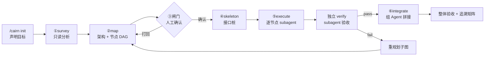

# cairn-pi

**把「需求 → 架构 → 节点骨架 → 逐节点开发 → 整体验收」变成一条可追踪的流水线。**
黑板状态机 + 原生 subagent，每个节点上下文独立，验收不可自证。

[](https://pi.dev)
[](https://pi.dev)
[](https://github.com/0xC4m3l-jiang/Cairn-pi/actions/workflows/verify.yml)
[](LICENSE)

## 解决什么

单发 agent 做多模块需求时的三个老问题：

| 问题 | 本包的做法 |
| --- | --- |
| 上下文越跑越长，后半程开始重复自己 | 每个节点一个 subagent，只拿节点需求 + 接口签名 |
| 「我做完了」由模型自述 | 节点完成状态是**派生量**，靠证据算出来 |
| 需求漏实现、没人发现 | 需求 ↔ 节点 ↔ 验收级别的追溯矩阵 |

架构来源是 [Cairn](https://github.com/oritera/Cairn) 的黑板/事实-意图图，加上 plan-first 的节点状态机。
差异与代价见 [`DESIGN.md`](DESIGN.md) 附录 A。

## 工作方式



三个硬边界：

- **门禁在代码里**：依赖没完成不能认领；触碰文件越界被拒；无证据不能标记完成
- **验证者不能写代码**：verify subagent 只有 `read,grep,find,ls,bash`
- **最终判定权不交给代理**：命令一致性 + 证据形状 + `module` 级由扩展复跑

## 安装

```bash
pi install npm:cairn-pi
```

不长期安装、只试一次：

```bash
pi -e npm:cairn-pi
```

本地开发时指向包目录（**M5 前不可用**：`extensions/` 与 `skills/` 尚未创建，见 `DEVELOPMENT.md` §5 里程碑）：

```bash
pi -e ./cairn-pi
```

Pi 扩展以 Pi 的权限运行。只从可信来源安装。

## 快速开始

```text
/cairn init --goal "登录支持 magic link"
/cairn map                 # 分析代码库 → 出架构与节点图，停在闸门
/cairn status --plan       # 看计划，改到满意
/cairn execute             # 骨架 + 逐节点开发（每节点走独立 subagent）
/cairn integrate           # 拼接 + 整体验收
/cairn resume              # 中断恢复：把卡在 running 的节点重置为 ready
/cairn report              # 追溯矩阵：需求 ↔ 节点 ↔ 验收 ↔ 证据
```

也可以只用一个阶段——比如已有代码只想要验收：

```text
/cairn init --goal "确认支付模块没有回归"
/cairn map --verify-only
```

## 配置

项目根 `.cairn/config.json`：

```jsonc
{
  "levels": [
    { "id": "unit",       "required": true, "how": "npm test -- {tests}" },
    { "id": "probe",      "required": true, "how": "node --test {probes}" },
    { "id": "module",     "required": true, "how": "npm run test:integration", "scope": "integrate" }
  ],
  "maxAttempts": 2,
  "reverifyModule": true,
  "budget": { "maxTotalAttempts": 20, "maxWallClockMinutes": 60 }
}
```

| 字段 | 含义 |
| --- | --- |
| `levels[].id` | 验收级别名，节点与整体都可引用 |
| `levels[].how` | 命令模板，占位符只有 `{tests}` / `{module}` / `{probes}` |
| `levels[].scope` | `node`（默认）/ `integrate`（只在整体阶段跑） |
| `maxAttempts` | 单节点失败重试上限，超过触发重规划 |
| `reverifyModule` | `module` 级是否由扩展复跑复核 |
| `budget.maxTotalAttempts` | 全流程 attempt 总上限，超过即 `BUDGET_EXHAUSTED` |
| `budget.maxWallClockMinutes` | 墙上时间上限（从 `/cairn map` 起算），超过即 `BUDGET_EXHAUSTED` |

占位符只有三个：`{tests}` → 节点 `tests` 空格连接；`{module}` → 节点所属模块；`{probes}` → 节点 `probes` 空格连接。

**`probe` 级不建议省**：给定测试只覆盖需求的一部分，需求里未写成测试的条款只靠 `tests` 验收一定会漏。`probe` 逼实现者逐条落成断言。

## 包结构

```text
cairn-pi/
├── extensions/cairn.ts       # 扩展入口：状态机 + 门禁 + 命令
├── lib/                      # 纯函数层，可脱离 pi 单测
├── skills/                   # cairn-map / cairn-execute / cairn-integrate
├── docs/                     # 设计文档与 Cairn 架构提取
└── tests/
```

## 文档

| 文档 | 内容 |
| --- | --- |
| [`DESIGN.md`](DESIGN.md) | 设计定稿：数据模型、状态机、切片规则、验收机制、非目标 |
| [`DEVELOPMENT.md`](DEVELOPMENT.md) | 开发文档：模块职责、接口契约、里程碑顺序、测试策略 |
| [`docs/cairn-architecture.md`](docs/cairn-architecture.md) | Cairn 核心架构提取（6 条可迁移原则） |
| [`docs/cairn-core-dispatch.md`](docs/cairn-core-dispatch.md) | Cairn dispatch 实现细节（源码对照） |
| [`AGENTS.md`](AGENTS.md) | 本项目的开发规范 |
## 对比：原生 pi vs cairn-pi

同一条需求、同一份验收测试，两条路线各跑一次，指标在开跑前固定。
复现脚本与完整历史见 [`demo/RESULTS.md`](demo/RESULTS.md)。

测试任务是 **5 模块事件溯源系统**（`events` / `inventory` / `orders` / `snapshots` / `reports`）：
append-only 日志、幂等下单、库存原子性、浅拷贝隔离。25 条给定测试 +
**12 条隐藏探针**（两组均未见过）+ **8 维盲评**（代码拷到中性目录打乱、冷上下文评审、事后解盲）。
需求见 [`demo/requirement-hard/REQ.md`](demo/requirement-hard/REQ.md)。

### 结果

| 指标 | 原生 pi | cairn-pi | 结论 |
| --- | --- | --- | --- |
| 给定测试 | 25/25 | 25/25 | 平 |
| **隐藏探针（12 条）** | 11/12 | **12/12** | **cairn-pi** |
| **8 维盲评（两名独立评审，满分 40）** | 24 / 22（均值 23） | **39 / 34（均值 36.5）** | **cairn-pi** |
| 逐条需求证据链 | ❌ 无 | ✅ 5 节点 × 三层证据 | **cairn-pi** |
| 中断可恢复 | ❌ 无 | ✅ `.cairn/board.json` | **cairn-pi** |
| 范围控制 | ⚠️ 多写 `docs/Log.md` | ✅ 仅 `.cairn/` | cairn-pi |
| 分支点总数 | 13 | 8 | cairn-pi |
| 注释行 | 1 | 27 | cairn-pi |
| 代码行数 | 189 | 199 | 平 |
| Token 总量 | 227,250 | 2,045,252 | **原生 pi 省 9.0×** |
| 成本 | $0.109 | $0.477 | **原生 pi 省 4.4×** |
| 耗时 | **107 秒** | 304 秒 | **原生 pi 快 2.8×** |

> 方差标注：原生 pi 是同一份代码，两轮评审给出 24 与 30 分（差 6 分）。均值方向可信，分值精度有限；每组只跑 1 次。

### Token 消耗

每轮用 `--session-dir` 隔离 pi 会话，从 session JSONL 累计每条 assistant 消息的 `usage`
（[`demo/token-usage.mjs`](demo/token-usage.mjs)）。同一条需求、同一模型，各跑一次。

| 任务 | 组 | input | output | cacheRead | **total** | 成本 | 消息 |
| --- | --- | --- | --- | --- | --- | --- | --- |
| 复杂（4 模块 / 15 用例） | 原生 pi | 26,474 | 12,771 | 571,520 | **610,765** | $0.173 | 19 |
| | cairn-pi | 39,887 | 16,027 | 1,506,560 | **1,562,474** | $0.344 | 34 |
| | **倍率** | 1.51× | 1.26× | 2.64× | **2.56×** | **1.98×** | 1.79× |
| 高难（5 模块 / 25 用例） | 原生 pi | 24,633 | 10,873 | 191,744 | **227,250** | $0.109 | 7 |
| | cairn-pi | 46,836 | 31,568 | 1,966,848 | **2,045,252** | $0.477 | 37 |
| | **倍率** | 1.90× | 2.90× | 10.26× | **9.00×** | **4.39×** | 5.29× |

三点观察：

- **增量几乎全在 `cacheRead`**（上下文被重复读取），占 cairn-pi 总量的 80%–96%；输出 token 只涨 1.3–2.9 倍
- **成本随节点数线性增长**：cairn-pi 约 39–41 万 tokens / 节点（4 节点 → 156 万，5 节点 → 205 万）
- **倍率取决于原生 pi 需要几次往返**：高难任务上原生 pi 一次成型（7 条消息），cairn-pi 的固定开销被放大到 9 倍；复杂任务上原生 pi 用了 19 条，差距缩到 2.56 倍

**结论**：cairn-pi 的 token 溢价是 2.5–9 倍、成本溢价 2–4.4 倍，且随节点数线性增长。
节点越多，绝对花费越高，但相对倍率会向「原生 pi 的往返次数」回归。

### 代码级对比

#### ① 模块划分

同样 5 模块、**零 import**、纯工厂注入（`createOrders(eventLog, inventory)`）、依赖方向一致。差别在出口边界：

| 项 | 原生 pi | cairn-pi |
| --- | --- | --- |
| 返回内部活对象的出口 | **4 处**（`append`、`placeOrder`、`cancelOrder`、`getOrder`） | **0 处** |
| 模块边界可被外部改穿 | 是 | 否 |

#### ② 链路逻辑

| 链路 | 原生 pi | cairn-pi |
| --- | --- | --- |
| inventory 写操作 | 先 append 事件，后改 Map ✅ | 同 ✅ |
| `orders.cancelOrder` | **release 库存 → 改 status → 最后 append** ❌ | **append → 改 status → release** ✅ |
| 取消事件载荷 | `{id}` — 下游无法重建 | `{id, sku, qty, key}` ✅ |
| `rebuild` 传给 reducer 的实参 | **4 个**（多传 index/array） | **2 个** ✅ |

原生 pi 的取消事件不带 sku/qty，任何想从事件日志重建订单投影的下游模块都拿不到数据——事件溯源链在取消这一步断了。

#### ③ 函数规范

| 项 | 原生 pi | cairn-pi |
| --- | --- | --- |
| `placeOrder()` 无参调用 | `TypeError: Cannot destructure property 'sku'` | `Error: quantity must be a positive integer` ✅ |
| 公开 API 返回副本 | 否（部分） | 是（全部） ✅ |
| `levels()` 副本实现 | 普通 `{}` | `Object.create(null)` ✅ |
| 校验器重复 | 2 处，**两种写法** | 2 处，**同一写法** ✅ |
| 最长单函数 | 55 行 | 50 行 |
| 事件类型字符串硬编码 | 5 处 | 5 处（共同短板） |

#### ④ 数据正确性：原生 pi 的一个真 bug

```text
原生 pi  : stock("__proto__") = 5，但 levels() 不含它 → summary().totalStock = 9（应为 14）
cairn-pi : stock("__proto__") = 5，levels() 保留   → summary().totalStock = 14 ✅
```

普通 `{}` 做副本时，`__proto__` 这个合法 sku 名被静默丢弃。探针 P12 抓到的就是它。

#### ⑤ 共同短板（两者都有）

- 事件类型字符串裸写 5 处，没有常量表；新增类型要改多个文件
- `assertPositiveInteger` 在 `inventory` 与 `orders` 各写一份，未提取共享模块
- `new Date()` 硬编码，时钟不可注入
- 都假设订单只有两个 status；出现第三种会被静默漏计
- **cairn-pi 自身一处注释与代码不符**：注释写「幂等表只在成功后写入」，但 `byKey.set` 在 `eventLog.append` 之前

### 结论

cairn-pi 在本轮**逻辑质量更高**（探针 12/12 vs 11/12；盲评 36.5 vs 23），代价是 **4.5 倍耗时**。

它提升质量的机制不是「更聪明」，而是**把好实践变成不可跳过的步骤**：
规格条款必须落成 `probes` 断言，工程约定写进每个节点 brief。约定写得不全，它就不比原生 pi 强。

### 按场景选

| 场景 | 用哪个 |
| --- | --- |
| 单文件小改动、一次性任务 | 原生 pi（快得多，质量差距不明显） |
| 多模块需求、要写对代码 | cairn-pi（盲评 36.5 vs 23） |
| 需要交接 / 审计 / 回溯某条需求的证据 | cairn-pi（唯一不可替代的能力） |
| 长任务、可能被打断 | cairn-pi（`board.json` 能接着做） |
| 已有完整测试、只想批量跑验收 | cairn-pi（`--verify-only`） |

> 想让 cairn-pi 真的提升逻辑质量：把工程约定写进包（`lib/conventions.ts`），并把规格条款全部落成测试或探针。它只守你给它的边界。

## 非目标

不做并行节点执行（v1 串行）、不做图形化 TUI、不做跨会话多项目、不做远程 server。
理由见 [`DESIGN.md`](DESIGN.md) §12。

## License

MIT
